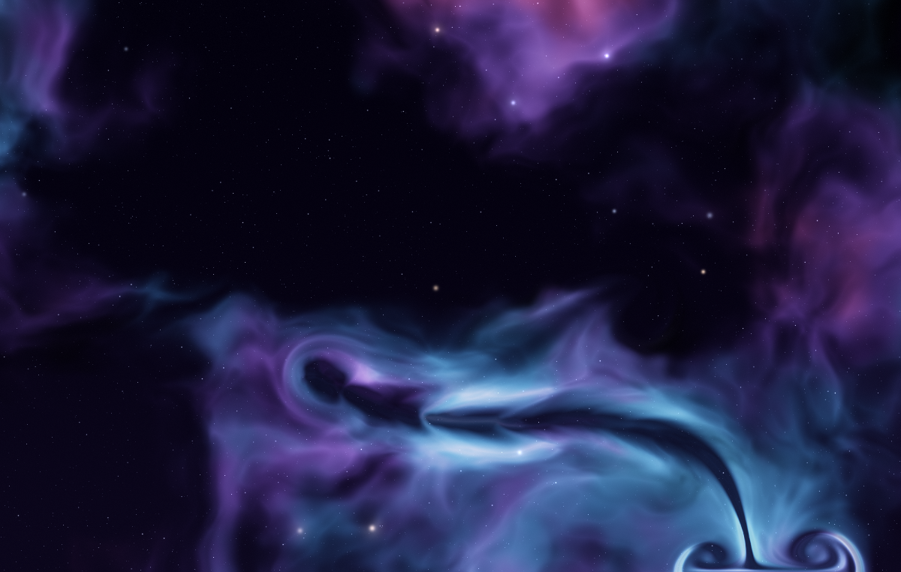

# Nebula cursor

A fixed, fullscreen WebGL2 nebula you can part with your mouse. The cursor
bends a displacement field rather than moving color: clouds thin where you
pass, pile up at the rim, and always heal back to the untouched procedural
cloud. Colors never mix, so the nebula can't be stirred to mud.

Try it in the gallery: `bun run dev` from the repo root, then open `/nebula/`.



Extracted from a larger scroll-narrative site — this is the pure nebula +
cursor interaction, framework-free. Formerly its own `nebula-cursor` repo.

## Use

```js
import { mount } from '@spectra/nebula';

const nebula = mount(document.querySelector('#hero')); // a positioned, sized box
nebula.config.offsetDecay = 1.2; // live tuning
nebula.destroy();
```

Options: `tier` locks a quality tier (0–3, 4 = static fallback); `debug` logs
governor decisions. In the gallery these are `?tier=` and `?perf`.

## How it works

The cloud texture is recomputed every frame: a procedural base nebula (fbm +
domain warp + ridged filaments + dust lanes) sampled through a displacement
field. The cursor writes into that field two ways — a local radial shove
(the parting) and a soft directional drag pushed through a GPU fluid sim (the
wake). The field decays back to zero over ~1s, so the cloud always relaxes to
its rest shape. Divergence of the displacement thins stretched gas and
brightens compressed gas, which is what makes a push read as *parting* rather
than refraction.

| File | Role |
|---|---|
| `src/index.js` | `mount()`: stage, pointer splats, render loop, governor wiring |
| `src/fluid.js` | Velocity sim (advect, pressure projection), displacement update, cloud render + `CONFIG` tuning |
| `src/shaders.js` | All GLSL: sim kernels, procedural base nebula, composite (space gradient + parallax stars + gas-gated glow) |
| `src/perf.js` | FPS governor: quality-tier ladder down to a static CSS fallback |

WebGL2 helpers and the canvas/pointer/loop stage come from `@spectra/core`.

Requires WebGL2 + `EXT_color_buffer_float`; otherwise the container gets the
`nebula-fallback` class for a static CSS gradient. Cursor interaction is mouse-only (touch is left free). Respects
`prefers-reduced-motion` (freezes the drift and sim).

## License

MIT
